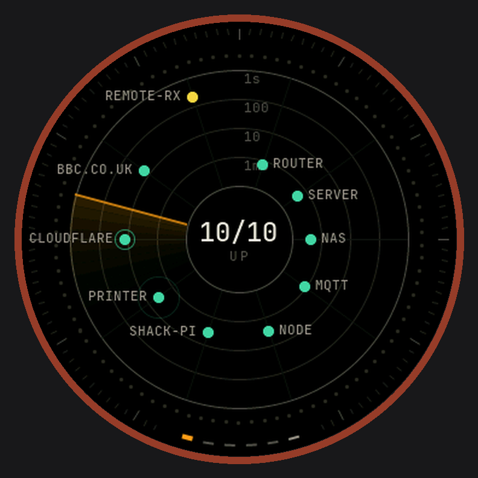
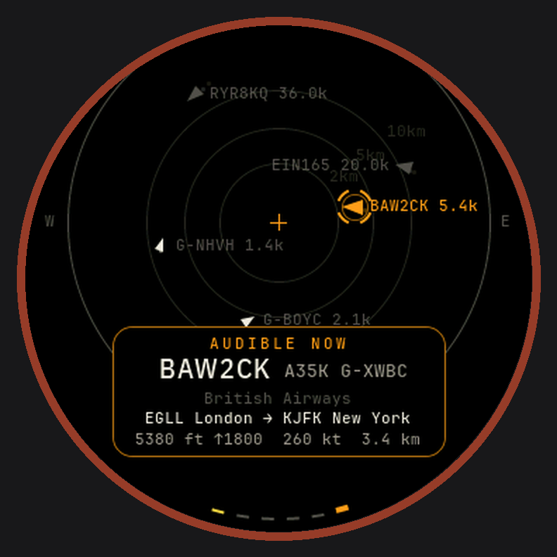
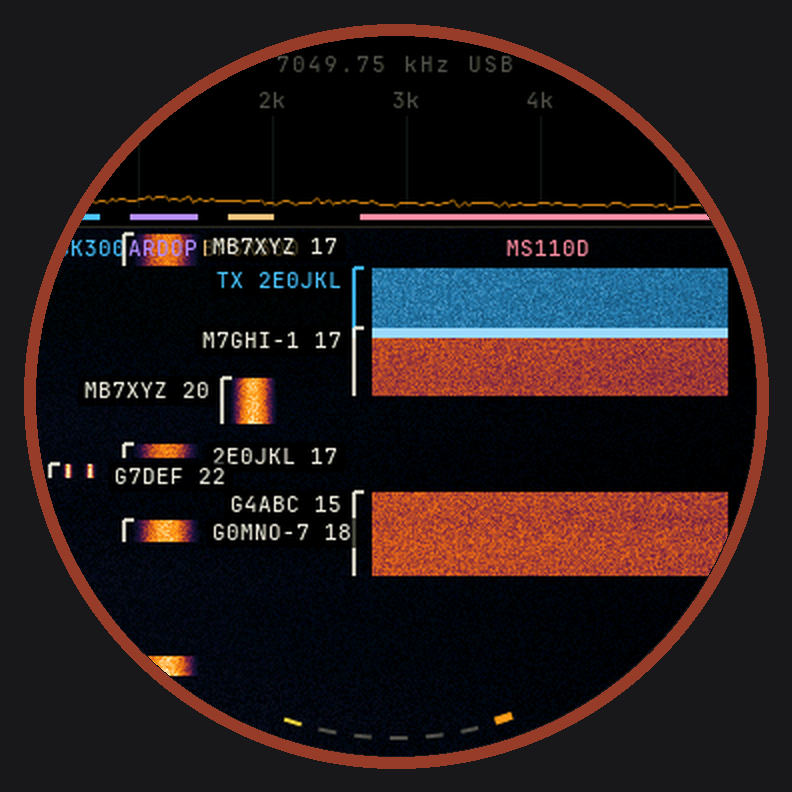
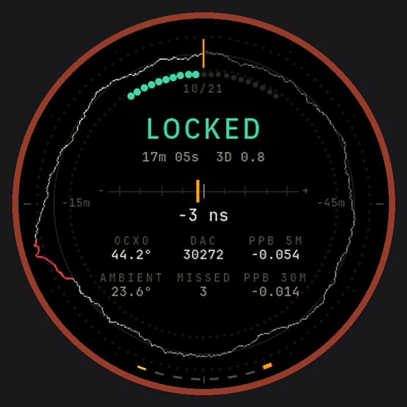
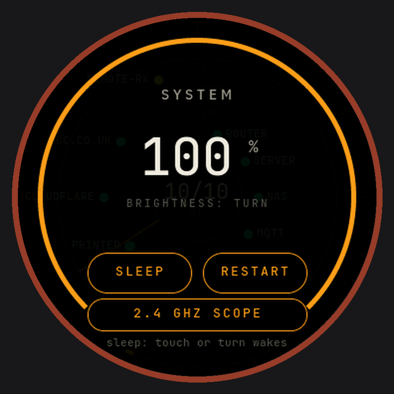

# esp32-knob-pages

A desk status display for the Guition JC3636K718 round knob (ESP32-S3, 1.8 inch 360x360 touch screen, rotary bezel, LED ring, haptics, speaker, mic). It shows a set of pages you flip through with the bezel, each drawn by hand in LVGL to suit what it shows, and raises alerts when something needs attention. Everything runs on the knob: it fetches its own data, serves its own settings page, and needs no server.

Board bring-up, pin map and hardware notes: https://github.com/M0LTE/esp32-knob

| | | |
|---|---|---|
|  |  |  |
|  |  |  |
|  |  |  |

(Simulator renders on made-up data. Animated versions are in `renders/`.)

## Pages

| Type | Shows | Data |
|---|---|---|
| `hosts` | Hosts on a polar plot by round-trip time, a sweep, loss and a trace per host | ICMP ping from the knob |
| `station` | Live packet radio traffic on a ten-minute clock, newest frames, rates | A KISS TCP port, listen only (the code never writes to it) |
| `modem` | Stations heard with SNR, receiver load and real-time ratio, transmit stalls | pdn-soundmodem's Prometheus `/metrics` |
| `energy` | Live power flows (solar, grid, house, battery), state of charge, the next 24 h of planned battery level and tariff | Home Assistant REST API: a solar/battery inverter's sensors and Predbat's plan and rates |
| `rooms` | A thermostat dial per room: temperature, target, humidity, A/C and radiator state; set the target with the bezel | A climate controller API returning per-zone decisions (shape in `test/brain_state_sample.json`); targets are written to Home Assistant `input_number` helpers |
| `waterfall` | The station's receive passband as a live waterfall with its modems' bands and decoded frames tagged; tap to listen to the receive audio, bezel for volume | A pdn-soundmodem station page WebSocket (spectrum lines, frames, and audio on request) |
| `sky` | Aircraft near home on a local map, which ones you are likely to hear, and a soft notice before one passes over | readsb `re-api` JSON for a box round home (adsb.oarc.uk by default) and adsbdb.com for routes |
| `doorbell` | The door camera near-live (a few frames a second); a ring wakes the screen, jumps here with a ding-dong, and goes back after 90 s or a tap | Home Assistant: a ring sensor (`binary_sensor`, off to on) polled every second, and the camera through `/api/camera_proxy` (JPEG, resized by HA, decoded on the knob and kept only in its RAM) |
| `gpsdo` | A GPS-disciplined oscillator: lock, phase error over the last hour on a clock ring, satellites, oscillator temperature and frequency error | A JSON status document on MQTT (the knob subscribes only, never publishes) |

Each page is one file in `ui/pages/` with its own drawing, input and alert logic. Adding a page means writing one and listing it in `ui/ui.c`.

**System menu.** Press and hold anywhere for 1.2 s. The bezel then sets the screen brightness (kept across restarts), and two buttons put the knob to sleep or restart it; a tap elsewhere closes the menu. Sleep turns the screen off: backlight faded out, panel display off, LED ring off, speaker stopped; Wi-Fi and every source keep running, so the pages are current the moment it wakes. A touch or a turn of the bezel wakes it (that touch or step does nothing else), and so does a critical alert. The board cannot switch its own power off: the base's slide switch is in series with the battery.

**2.4 GHz scope.** The system menu's `2.4 GHZ SCOPE` button turns the knob's own Wi-Fi radio into a receive-only spectrum analyser: a live spectrum and waterfall from 2200 to 2700 MHz, the bezel tunes, a tap changes the span (40, 20, 10, 5, then 100 and 60 MHz and round again), `EXIT SCOPE` goes back. It opens on 40 MHz; the 100 MHz span opens centred on 2442 MHz, which shows all of 2.4 GHz Wi-Fi (2400 to 2483.5 MHz, channels 1 to 13) with a few MHz either side. The ruler numbers the Wi-Fi channels and draws the non-overlapping 1, 6 and 11 as 20 MHz brackets (13 below them, fainter, as it overlaps 11), with a faint band behind the trace and faint edge lines down the waterfall for each; channel numbers thin out when they would crowd, and the 13 cm amateur band is a purple bar. The radio cannot listen and stay on the network at once, so entering restarts the knob into a scope boot with no Wi-Fi connection, web server or sources (alerts are held), and leaving restarts it back to the pages (about 10 s each way). The samples come from the receiver's undocumented debug dump engine as found by ESP-SDR (see [NOTICE](NOTICE)): 16,380 I/Q pairs at 40 MS/s (spans 40 and 20) or 16 MS/s (10 and 5), two snapshots a row, 1024-point FFTs averaged, about 15 rows a second. The 100 and 60 MHz spans are swept: the receiver steps across the span in tiles captured at the ADC's full 80 MS/s (5 for 100 MHz, 3 for 60), each used only from 2 to 20 MHz either side of its own centre (clear of the LO notch, inside the flat part of the analogue filter) and overlapping its neighbours, which blend over the overlap; a response learnt from the sweep itself (for each frequency offset, a quiet value across the tiles, smoothed) evens out the tiles so no seams show. The tiles are not taken at 40 MS/s because that rate is the ADC's stream with every other sample dropped and nothing filtered first: a signal 20 to 40 MHz from the tuned centre folds back in almost at full strength (a busy Wi-Fi channel 25 MHz away measured 3 dB down), so a strong channel appeared again 40 MHz either side of itself. At 80 MS/s what folds in comes from 60 MHz away or more, where the filter has removed it (nothing visible, at least 38 dB down). Wi-Fi is bursts and a sweep listens to each tile only a fraction of the time, so a tile takes 12 short captures back to back and keeps the strongest per frequency, and every column shows its strongest value of the last second and a half; a busy channel is then one steady block instead of flickering in pieces as its beacons land in one tile after another. The trace is refreshed tile by tile along the sweep, and the waterfall gets one row for every complete sweep: about 6 rows a second at 100 MHz and 10 at 60. The 40 MHz span is still a single 40 MS/s capture, so it can show such a folded copy of a strong signal that sits 25 to 40 MHz from the tuned centre (tuned to channel 1, a busy channel 6 appears again at the left edge); the 20 MHz span's narrower filter stops it. The display stays at about 29 fps throughout. The levels are relative (the page auto-levels), the centre has a notch for the receiver's own LO leakage, and the analogue filter is narrowed to suit the span. Nothing is transmitted: Wi-Fi runs with no interface and the transmit chain is switched off. The 64 KB the dump engine writes into is kept out of the heap only in a scope boot; a normal boot gives it back. A new update that is still on trial waits until it is confirmed before entering (restarting it would roll it back), and any crash in a scope boot comes back as a normal boot. `POST /api/test/scope?secs=60&mhz=2442&span=100` (admin) enters it at a fixed centre and span (100, 60, 40, 20, 10 or 5) and comes back by itself after `secs`.

Deep sleep (the ESP32-S3's own, with touch and the bezel as wake sources) is not used. On this board a timer wake, and timer plus the touch and bezel lines as wake sources, both worked every time on their own (woke after 10 s, USB came back), but the full sleep path once stayed asleep for about five minutes and USB did not come back until the lead was replugged. The likely culprit is `gpio_deep_sleep_hold_en()` (used to hold the backlight pin low), which holds every digital pad through sleep, the USB pins among them; untested. The code that remains is the wake logging at start-up and a 1 s start-up delay after a deep-sleep wake.

Alerts come in four strengths: a notice (soft chime, jump to the page, clears itself), a call (the doorbell: wakes the screen, jumps to the page with a ding-dong and white sweeps on the LED ring, and goes back to the page you were on when it ends or you tap), a warning (the page's dot turns yellow) and critical (wakes the screen, jump, sound, red rim, LED ring, until tapped). `POST /api/test/ring` (admin) acts as if the doorbell rang, to try the whole path.

## Layout

| Path | What |
|------|------|
| `ui/` | Portable LVGL 9.3 UI with no ESP-IDF includes: the pager and alerts (`ui.c`), drawing helpers (`theme.c`), the data model (`model.h`), pages, fonts |
| `main/` | ESP-IDF 5.5.1 app: board, Wi-Fi and set-up access point, settings and web page, one source task per data feed |
| `sim/` | Desktop simulator running the real `ui/` code on fake data |
| `test/` | Host tests for the parsers (`make && ./test_parsers` etc.) |
| `config/defaults.example.json` | An example build-time defaults file |
| `docs/memory.md` | Where internal RAM goes, how to measure it, and what the memory pass changed |

## Build and flash

```
. ~/esp/esp-idf-v5.5.1/export.sh
idf.py build                                              # generic defaults: every source unconfigured
idf.py -DDESK_DEFAULTS=my-defaults.json build             # or with your own defaults baked in
esptool --port /dev/ttyACM0 --before usb-reset --after watchdog-reset write-flash --flash-mode keep --flash-freq keep --flash-size keep \
  0x0 build/bootloader/bootloader.bin 0x8000 build/partition_table/partition-table.bin \
  0xe000 build/ota_data_initial.bin 0x10000 build/desk_knob.bin
```

That USB flash is needed once; after it, update over Wi-Fi (below). Don't pass `--flash-mode qio` to esptool: it rewrites the bootloader header and the board then fails to boot. Partitions: NVS (settings, 20 KB at 0x9000), OTA data, two 4 MB app slots (`ota_0` at 0x10000, `ota_1`), and a 256 KB core dump partition. To start again from default settings erase only NVS: `esptool erase-region 0x9000 0x5000`.

**First start.** With no Wi-Fi saved (or if the saved network cannot be joined within 30 s at boot) the knob starts an access point `DESK-KNOB-SETUP` and shows its password and a QR code on the screen. Join it from a phone (scan the QR code, or type the password); the set-up page should pop up, otherwise open http://192.168.4.1/. Enter the Wi-Fi name and password and choose an admin password (6 characters or more), then Apply. The knob restarts and joins the network as `desk-knob` (DHCP host name, no mDNS). The full settings page is then at http://desk-knob/ (or its IP, shown on the screen while it connects), user name `admin` and the admin password. If the network goes missing at boot the AP comes up again, and the knob restarts by itself once the network is back and nobody is using the AP.


**Settings** are one JSON document in NVS, edited on the knob's own web page: Wi-Fi, host name, admin password, page list, hosts to ping, the KISS feed, the metrics URL, Home Assistant URL, token and entity ids, the climate controller and its rooms, home location for the aircraft page, the waterfall station page, the MQTT broker and GPSDO topic, the doorbell sensor and camera, screen brightness, and alert sound with quiet hours. The compiled-in defaults are generic and leave every source unconfigured. A build can carry its own defaults with `-DDESK_DEFAULTS=file.json` (same schema, see `config/defaults.example.json`), applied whenever NVS holds no settings yet. Secrets never come from a build: a Wi-Fi password, admin password, Home Assistant token or home location in that file is ignored, so keep those on the device. `/settings.json` shows the current settings without secrets.

## Updates

After the first USB flash the knob updates over Wi-Fi:

```
python3 tools/ota.py --host desk-knob build/desk_knob.bin
```

The tool (Python 3 standard library only) uploads the app image to `POST /api/ota` with the admin user name and password. The password comes from `$DESK_KNOB_PASSWORD` or the first line of `~/.config/desk-knob/admin` (`--password-file` to use another file); it is never printed. The knob checks that the image is for this chip and this project, writes it into the other app slot as it arrives (progress on the screen), checks it, replies with its version and restarts into it. Updates are refused on the set-up access point, when no admin password is set, and while another upload is running.

A new image is on trial. It keeps itself only when, within 90 s of starting, it has an address on the network (or its set-up access point is up), its web server answers, it has drawn frames and it has run for 30 s. Otherwise, or if it crashes first, it restarts and the bootloader goes back to the previous image. The tool watches `/api/version` and says whether the new version stayed or was rolled back.

A crash restarts the knob (after printing the panic on the USB console) and leaves a core dump in flash: `GET /api/crash` (admin) returns the reset reason and the crashed task, PC and backtrace (decode with `xtensa-esp32s3-elf-addr2line -pfiaC -e build/desk_knob.elf ADDRESSES`), and `DELETE /api/crash` clears it. The app waits 5 s after power-on before touching any hardware, so USB stays reachable even in a crash loop.

The version is `git describe --always --dirty` of the tree it was built from (or `-DDESK_VERSION=...`). It shows on the settings page, in `/settings.json`, the boot log and the console status line, and `GET /api/version` (no auth) returns `{"version", "partition", "idf"}`.

**Display.** The pages run at or near the 30 fps the UI's 33 ms frame timer allows: Station and Modem at 29.4 fps (17 to 21 ms a frame), Network at about 29 fps (29 to 30 ms a frame, the sweep is most of it). LVGL draws bands of 64 lines into two internal DMA buffers, already in the panel's byte order, and sends each band at 40 MHz QSPI while drawing the next. The pages redraw the whole screen every frame, so the work is kept down in `ui/theme.c`: each page's unchanging parts ("scenery") are drawn once into a PSRAM image and copied in, skipping all-black areas; long thin shapes (the sweep, arcs, long lines) are drawn in strips clipped to where they actually are, since LVGL otherwise works through their whole bounding box; big rings drawn every frame (the alert rim) are cached as A8 masks. All of these give the same pixels; the simulator renders are compared frame by frame. Things that did not help and are not used: full frames in PSRAM (24 ms a frame just moving memory), two LVGL draw threads, LVGL's hot code in IRAM. 90-line bands were 2 to 3 ms a frame faster than 60, but with Wi-Fi up they left no internal RAM to spare, so 72, and 64 since the memory pass ([docs/memory.md](docs/memory.md)). With an alert showing, the rim rings cost about 20 ms more a frame (about 20 fps until it is acknowledged). Bench build: `idf.py -B build-bench -DDESK_BENCH=1 build` runs the pages on made-up data with no network, cycling pages every 15 s, with `status:` lines every 5 s.


## Simulator

Renders pages exactly as the device draws them, at 16-bit colour, to PNG or GIF. It uses LVGL from the ESP-IDF component manager, so run `idf.py reconfigure` once first.

```
cmake -S sim -B sim/build && cmake --build sim/build -j8
sim/build/desk_sim tour /tmp/frames 15          # scenarios: hosts station alert tour modem energy rooms sky scope scope-wide
python3 tools/frames.py /tmp/frames tour.gif
```

## Fonts

JetBrains Mono and IBM Plex Sans Condensed, converted with lv_font_conv; both under the SIL Open Font License 1.1 (`ui/fonts/OFL-*.txt`).

## Licence

AGPL-3.0-or-later. See [LICENSE](LICENSE). The 2.4 GHz scope builds on ESP-SDR (GPL-3.0-or-later) and was checked against esp32-sdr-trx (0BSD); [NOTICE](NOTICE) says what came from where. The fonts in `ui/fonts/` stay under the SIL Open Font License 1.1.
