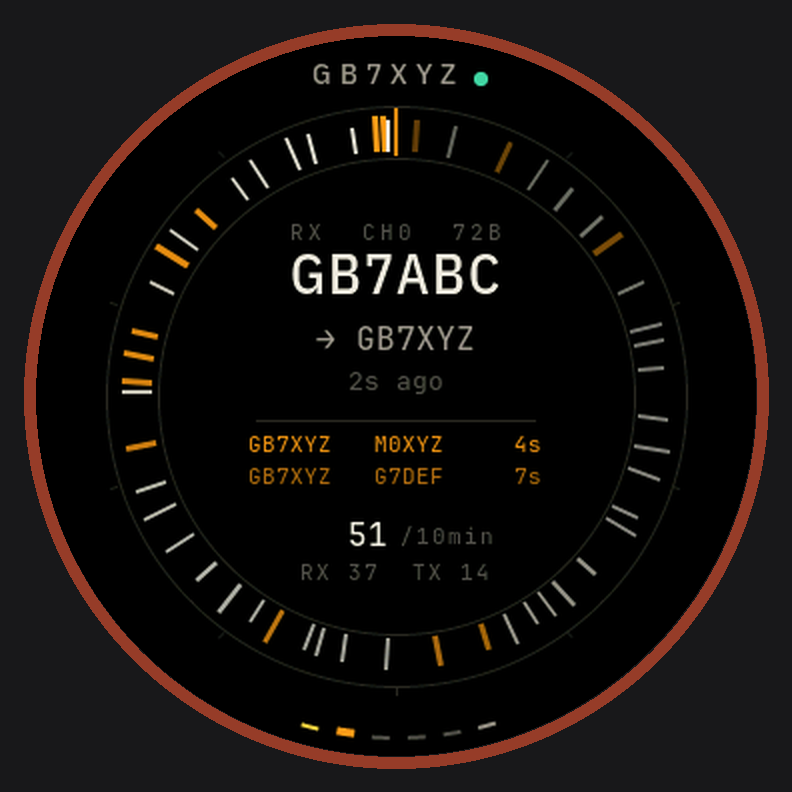
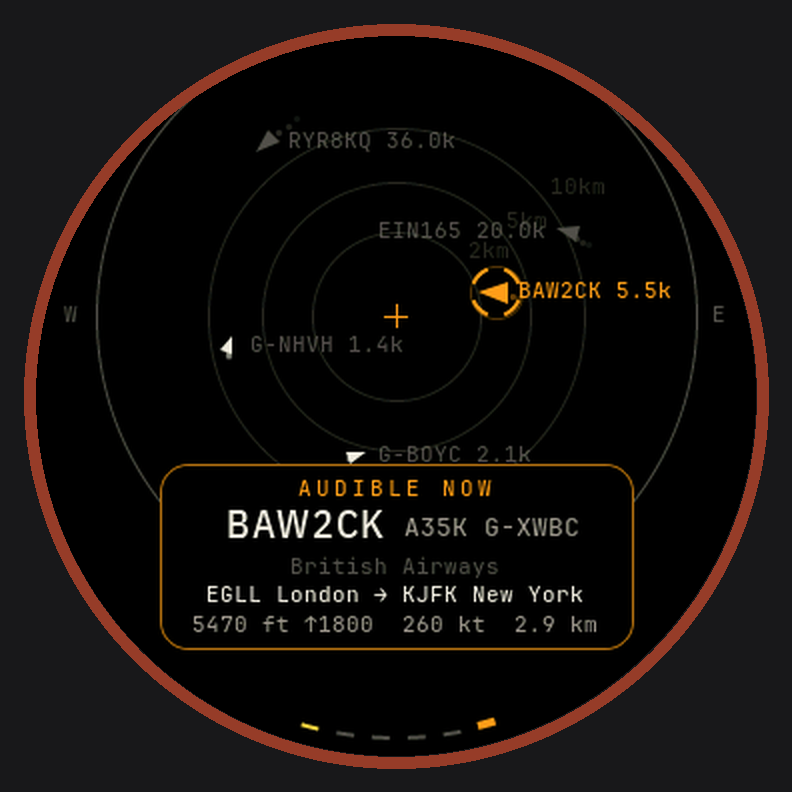
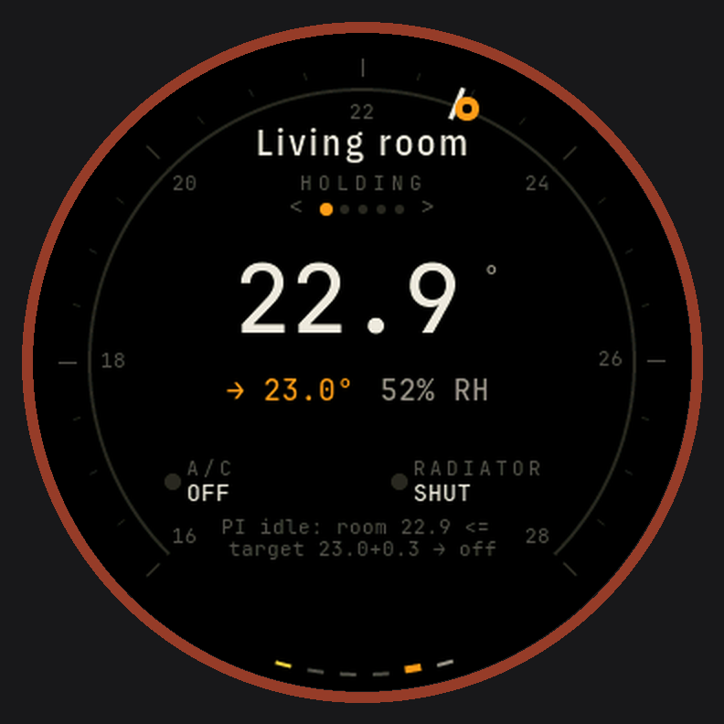
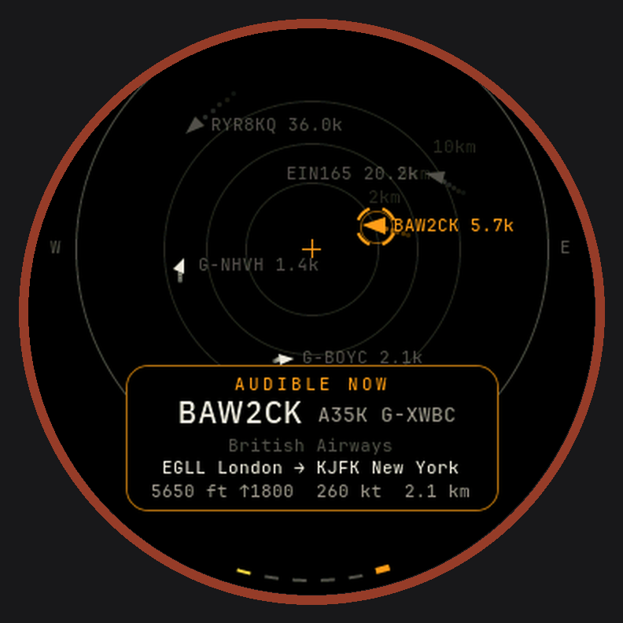

# esp32-knob-pages

A desk status display for the Guition JC3636K718 round knob (ESP32-S3, 1.8 inch 360x360 touch screen, rotary bezel, LED ring, haptics, speaker, mic). It shows a set of pages you flip through with the bezel, each drawn by hand in LVGL to suit what it shows, and raises alerts when something needs attention. Everything runs on the knob: it fetches its own data, serves its own settings page, and needs no server.

Board bring-up, pin map and hardware notes: https://github.com/M0LTE/esp32-knob

| | | |
|---|---|---|
|  |  |  |
|  |  |  |

(Simulator renders on made-up data. Animated versions are in `renders/`.)

## Pages

| Type | Shows | Data |
|---|---|---|
| `hosts` | Hosts on a polar plot by round-trip time, a sweep, loss and a trace per host | ICMP ping from the knob |
| `station` | Live packet radio traffic on a ten-minute clock, newest frames, rates | A KISS TCP port, listen only (the code never writes to it) |
| `modem` | Stations heard with SNR, receiver load and real-time ratio, transmit stalls | pdn-soundmodem's Prometheus `/metrics` |
| `energy` | Live power flows (solar, grid, house, battery), state of charge, the next 24 h of planned battery level and tariff | Home Assistant REST API: a solar/battery inverter's sensors and Predbat's plan and rates |
| `rooms` | A thermostat dial per room: temperature, target, humidity, A/C and radiator state; set the target with the bezel | A climate controller API returning per-zone decisions (shape in `test/brain_state_sample.json`); targets are written to Home Assistant `input_number` helpers |
| `sky` | Aircraft near home on a local map, which ones you are likely to hear, and a soft notice before one passes over | readsb `re-api` JSON for a box round home (adsb.oarc.uk by default) and adsbdb.com for routes |

Each page is one file in `ui/pages/` with its own drawing, input and alert logic. Adding a page means writing one and listing it in `ui/ui.c`.

Alerts come in three strengths: a notice (soft chime, jump to the page, clears itself), a warning (the page's dot turns yellow) and critical (jump, sound, red rim, LED ring, until tapped).

## Layout

| Path | What |
|------|------|
| `ui/` | Portable LVGL 9.3 UI with no ESP-IDF includes: the pager and alerts (`ui.c`), drawing helpers (`theme.c`), the data model (`model.h`), pages, fonts |
| `main/` | ESP-IDF 5.5.1 app: board, Wi-Fi and set-up access point, settings and web page, one source task per data feed |
| `sim/` | Desktop simulator running the real `ui/` code on fake data |
| `test/` | Host tests for the parsers (`make && ./test_parsers` etc.) |
| `config/defaults.example.json` | An example build-time defaults file |

## Build and flash

```
. ~/esp/esp-idf-v5.5.1/export.sh
idf.py build                                              # generic defaults: every source unconfigured
idf.py -DDESK_DEFAULTS=my-defaults.json build             # or with your own defaults baked in
esptool --port /dev/ttyACM0 --before usb-reset --after watchdog-reset write-flash --flash-mode keep --flash-freq keep --flash-size keep \
  0x0 build/bootloader/bootloader.bin 0x8000 build/partition_table/partition-table.bin 0x10000 build/desk_knob.bin
```

Don't pass `--flash-mode qio` to esptool: it rewrites the bootloader header and the board then fails to boot. Partitions: NVS (settings, 20 KB), OTA data, two 4 MB app slots. To start again from default settings erase only NVS: `esptool erase-region 0x9000 0x5000`.

**First start.** With no Wi-Fi saved (or if the saved network cannot be joined within 30 s at boot) the knob starts an access point `DESK-KNOB-SETUP` and shows its password and a QR code on the screen. Join it from a phone (scan the QR code, or type the password); the set-up page should pop up, otherwise open http://192.168.4.1/. Enter the Wi-Fi name and password and choose an admin password (6 characters or more), then Apply. The knob restarts and joins the network as `desk-knob` (DHCP host name, no mDNS). The full settings page is then at http://desk-knob/ (or its IP, shown on the screen while it connects), user name `admin` and the admin password. If the network goes missing at boot the AP comes up again, and the knob restarts by itself once the network is back and nobody is using the AP.


**Settings** are one JSON document in NVS, edited on the knob's own web page: Wi-Fi, host name, admin password, page list, hosts to ping, the KISS feed, the metrics URL, Home Assistant URL, token and entity ids, the climate controller and its rooms, home location for the aircraft page, and alert sound with quiet hours. The compiled-in defaults are generic and leave every source unconfigured. A build can carry its own defaults with `-DDESK_DEFAULTS=file.json` (same schema, see `config/defaults.example.json`), applied whenever NVS holds no settings yet. Secrets never come from a build: a Wi-Fi password, admin password, Home Assistant token or home location in that file is ignored, so keep those on the device. `/settings.json` shows the current settings without secrets.

**Display.** The pages run at or near the 30 fps the UI's 33 ms frame timer allows: Station and Modem at 29.4 fps (17 to 21 ms a frame), Network at about 29 fps (29 to 30 ms a frame, the sweep is most of it). LVGL draws bands of 72 lines into two internal DMA buffers, already in the panel's byte order, and sends each band at 40 MHz QSPI while drawing the next. The pages redraw the whole screen every frame, so the work is kept down in `ui/theme.c`: each page's unchanging parts ("scenery") are drawn once into a PSRAM image and copied in, skipping all-black areas; long thin shapes (the sweep, arcs, long lines) are drawn in strips clipped to where they actually are, since LVGL otherwise works through their whole bounding box; big rings drawn every frame (the alert rim) are cached as A8 masks. All of these give the same pixels; the simulator renders are compared frame by frame. Things that did not help and are not used: full frames in PSRAM (24 ms a frame just moving memory), two LVGL draw threads, LVGL's hot code in IRAM. 90-line bands were 2 to 3 ms a frame faster than 60, but with Wi-Fi up they left no internal RAM to spare, so 72. With an alert showing, the rim rings cost about 20 ms more a frame (about 20 fps until it is acknowledged). Bench build: `idf.py -B build-bench -DDESK_BENCH=1 build` runs the pages on made-up data with no network, cycling pages every 15 s, with `status:` lines every 5 s.


## Simulator

Renders pages exactly as the device draws them, at 16-bit colour, to PNG or GIF. It uses LVGL from the ESP-IDF component manager, so run `idf.py reconfigure` once first.

```
cmake -S sim -B sim/build && cmake --build sim/build -j8
sim/build/desk_sim tour /tmp/frames 15          # scenarios: hosts station alert tour modem energy rooms sky
python3 tools/frames.py /tmp/frames tour.gif
```

## Fonts

JetBrains Mono and IBM Plex Sans Condensed, converted with lv_font_conv; both under the SIL Open Font License 1.1 (`ui/fonts/OFL-*.txt`).
